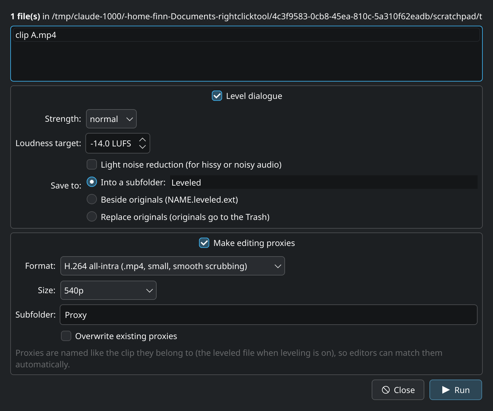

# footage-tools

Right-click tools for video footage on KDE Plasma (Dolphin). Select one or more clips,
right-click → **Footage tools…**, tick what you want, press **Run**.



## What it can do

| Option | What happens |
|---|---|
| **Level dialogue** | Makes speech consistently audible: high-pass → optional denoise → dynamic leveling → compression → two-pass EBU R128 loudness normalisation → true-peak limiter. Video is copied bit-for-bit, never re-encoded. |
| Save to: subfolder (default) | `clip.mp4` → `Leveled/clip.mp4` |
| Save to: beside originals | `clip.mp4` → `clip.leveled.mp4` |
| Save to: replace originals | Original moves to the Trash, leveled file takes its place (asks first, never remembered as the default). |
| **Make editing proxies** | Low-res, edit-friendly copies in a `Proxy/` subfolder, same base name as the clip. If leveling is on, the proxy is made from the leveled file (so it sits in `Leveled/Proxy/` and carries the leveled audio). |

Proxy formats: H.264 all-intra `.mp4` (default, small), ProRes 422 Proxy `.mov`, DNxHR LB `.mov`.
Sizes: 540p (default), 720p, 1080p, half, quarter. Portrait clips scale by their short side; never upscales.

Your choices are remembered between runs (`~/.config/footage-tools/footage-tools.conf`).

## Install

Needs `ffmpeg`, `python-pyqt6`, `kdialog`, `libnotify` (all present on CachyOS/Plasma).

```bash
./install.sh
```

This symlinks `bin/footage-tools` into `~/.local/bin` and adds the Dolphin service menu, so
`git pull` updates the tool in place. The old **Level dialogue** submenu stays until you run
`./install.sh --replace-legacy`, which backs it up to `~/.local/share/footage-tools-backup/` first.

## Command line

`bin/level-dialogue` still works on its own:

```
level-dialogue [--strength gentle|normal|strong] [--target -14] [--denoise]
               [--outdir Leveled | --replace] FILE...
```

`footage-tools FILE...` opens the window.

## Logs

- `~/.cache/level-dialogue.log` — leveling
- `~/.cache/footage-tools.log` — proxies

## Using proxies in an editor

- **Kdenlive:** Settings → Configure Kdenlive → Proxy Clips → enable *external proxy clips* and add a
  profile with proxy folder `Proxy/`, no prefix, and the proxy extension (`.mp4` or `.mov`) as suffix.
- **DaVinci Resolve:** proxies in a `Proxy` folder beside the media with the same name are what
  Resolve's *Link Proxy Media* expects.

See [SPEC.md](SPEC.md) for the intended behaviour and [CHANGELOG.md](CHANGELOG.md) for history.
